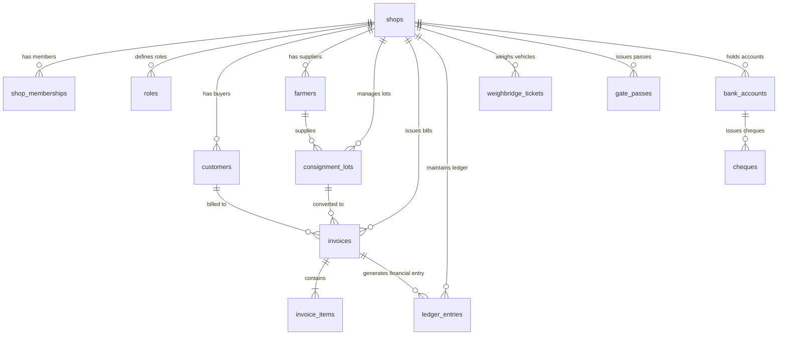

# Mandi — PostgreSQL Database Schema & ERD Documentation

## 1. Database Architecture Principles
- **Engine:** PostgreSQL on Supabase with `pgcrypto` extension for UUID generation.
- **Multi-Tenancy:** Tenant isolation strictly partitioned by `shop_id`.
- **Zero-Trust Security:** Client `shop_id` is never trusted for authorization; RLS policies verify active membership via `public.current_membership(shop_id)` matching `auth.uid()`.

## 2. Core Tables Dictionary

| Table Name | Primary Key | Foreign Keys | Purpose |
| :--- | :--- | :--- | :--- |
| `profiles` | `id` (UUID) | `references auth.users(id)` | User personal profile, normalized phone, CNIC |
| `shops` | `id` (UUID) | `owner_id -> auth.users(id)` | Mandi commission shop entity & business settings |
| `roles` | `(shop_id, id)` | `shop_id -> shops(id)` | Shop-scoped RBAC role matrix and permissions |
| `shop_memberships`| `id` (UUID) | `user_id`, `shop_id`, `role_id`| Multi-tenant membership binding users to shops |
| `products` | `id` (UUID) | `shop_id`, `supplier_id` | Commodity catalog (Wheat, Rice, Cotton, Corn) |
| `customers` | `id` (UUID) | `shop_id`, `user_id` (opt) | Buyers/Vyaparis, running balance, credit limits |
| `farmers` | `id` (UUID) | `shop_id`, `user_id` (opt) | Farmers/Zamindars, running balance, crop history |
| `consignment_lots`| `id` (UUID) | `shop_id`, `supplier_id` | Arriving trolley lots, auction status, winning bids |
| `invoices` | `id` (UUID) | `shop_id`, `customer_id` | Sales invoices with commission, Palladari, taxes |
| `invoice_items` | `id` (UUID) | `invoice_id`, `product_id` | Itemized line items with weights in KG and Maunds |
| `ledger_entries` | `id` (UUID) | `shop_id`, `customer_id`... | Double-entry financial journal (Debits & Credits) |
| `weighbridge_tickets`| `id` (UUID)| `shop_id` | Kanda gross, tare, and net weighment records |
| `gate_passes` | `id` (UUID) | `shop_id` | Inward and outward transport gate verification |
| `bank_accounts` | `id` (UUID) | `shop_id` | Shop commercial bank accounts & balances |
| `cheques` | `id` (UUID) | `shop_id`, `bank_account_id` | Cheque register (pending, cleared, bounced) |
| `storage_locations`| `id` (UUID)| `shop_id` | Warehouse bays, rooms, and cold storage sheds |
| `bardana_records` | `id` (UUID) | `shop_id` | Jute and plastic bag issuance and returns |
| `audit_logs` | `id` (UUID) | `shop_id`, `actor_id` | Immutable append-only audit trail of operations |

## 3. Entity Relationship Diagram (ERD)

